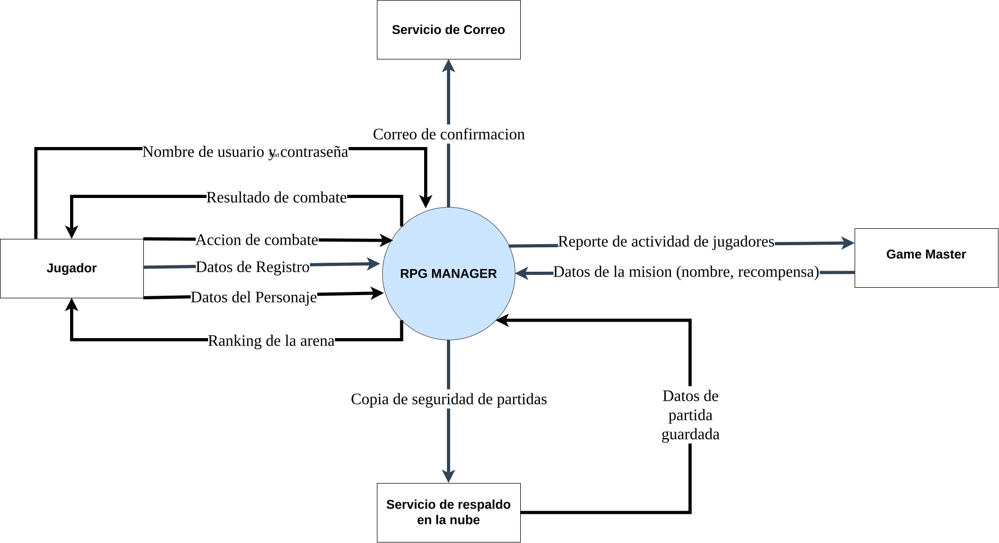
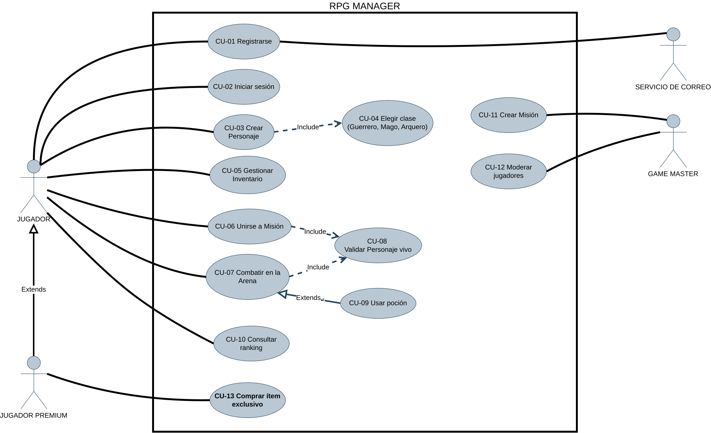
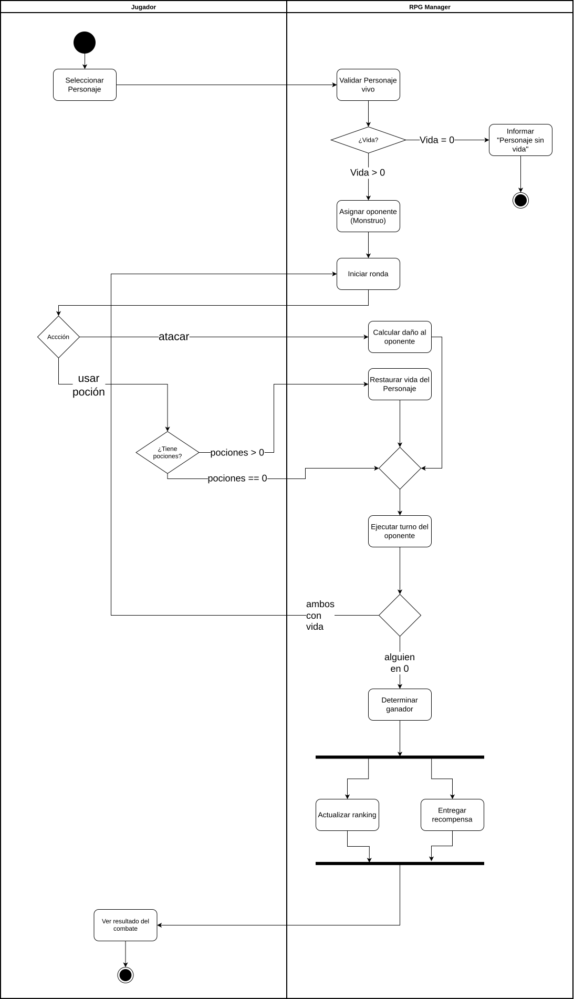
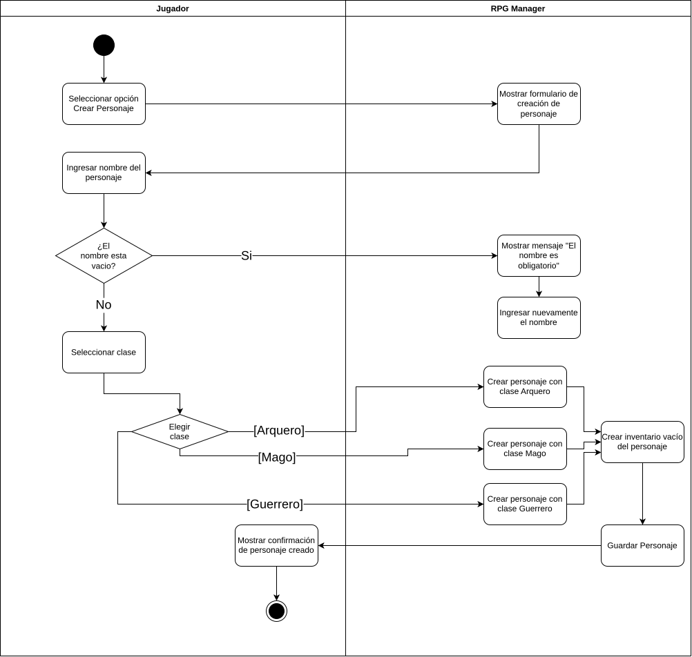

# Taller práctico – Análisis de Sistemas · RPG Manager

## 1. Diagrama de contexto

### Ejercicio 1A – Completar los flujos que faltan

**F10 – Inicio de sesión**
- **Origen:** Jugador.
- **Flujo de datos:** Nombre de usuario y contraseña.
- **Destino:** RPG Manager.

**F11 – Partida guardada**
- **Origen:** Servicio de Respaldo en la Nube.
- **Flujo de datos:** Datos de partida guardada.
- **Destino:** RPG Manager.

### Bugs del diagrama de contexto

**Error 1:** La Base de datos de Personajes aparece representada como una entidad externa. Esto es incorrecto porque la base de datos forma parte del funcionamiento interno del sistema RPG Manager.

**Error 2:** El flujo está nombrado como "Crear Personaje", pero ese nombre representa una acción o función del sistema, no la información que se transmite.

**Error 3:** En el diagrama aparece una flecha directa entre el Jugador y el Game Master con el nombre "mensaje". Esto no corresponde al diagrama de contexto planteado, porque las interacciones relacionadas con RPG Manager deben pasar por el sistema.

### Diagrama de contexto

---

## 2. Diagrama de casos de uso

### Ejercicio 2A – Generalización de actores

El RPG Manager tendrá un **Jugador Premium**, que puede hacer todo lo que hace el Jugador y además puede **Comprar ítem exclusivo**.

**¿Hacia dónde apunta el triángulo vacío y por qué?**

El triángulo vacío apunta hacia el actor **Jugador**, porque representa al actor general. El Jugador Premium es un tipo especializado de Jugador y hereda sus características y funcionalidades.

**¿Por qué el Jugador Premium NO necesita líneas a CU-01 … CU-10?**

Porque mediante la relación de generalización, el Jugador Premium hereda todos los casos de uso asociados al actor Jugador. Por eso no es necesario repetir las conexiones con CU-01 a CU-10. Solo se debe conectar directamente con el nuevo caso de uso **CU-13: Comprar ítem exclusivo**.

### Bugs del diagrama de casos de uso

**Error 1:** El caso de uso se llama "Inventario", pero debe nombrarse con una acción. Se debe cambiar por **"Gestionar Inventario"**.

**Error 2:** Los actores deben ubicarse fuera del límite del sistema. Se debe mover el actor Game Master hacia afuera del rectángulo.

**Error 3:** La flecha «include» está en la dirección incorrecta. Debe ir desde **CU-03 Crear Personaje** hacia **CU-04 Elegir clase**, porque crear un personaje incluye obligatoriamente elegir una clase.

**Error 4:** Existe una asociación directa entre los actores Jugador y Game Master, lo cual es incorrecto. Las asociaciones deben conectar actores con casos de uso, no actores entre sí.

### Diagrama de casos de uso

---

## 3. Diagrama de actividades – CU-07 Combatir en la Arena

### Ejercicio 3A – ¿Y si se acaban las pociones?

**¿En qué carril va la decisión?**

En el carril **Jugador**, porque se debe comprobar si el jugador tiene pociones disponibles.

**Guarda 1: `[pociones > 0]`**

Va a la acción **"Restaurar vida del Personaje"**.

**Guarda 2: `[pociones == 0]`**

Continúa directamente hacia el rombo de unión que conecta con la acción **"Ejecutar turno del oponente"**, sin pasar por "Restaurar vida del Personaje".

### Bugs del diagrama de actividades

**Error 1:** Toda decisión debe tener al menos dos alternativas. Se debe agregar la salida **[no]** y conectarla con la acción correspondiente.

**Error 2:** Se debe agregar un **join** para sincronizar ambos caminos y después continuar hacia un único nodo final.

**Error 3:** La acción **"Calcular daño al oponente"** está en el carril del Jugador, pero corresponde al sistema RPG Manager. Se debe mover esa acción al carril de **RPG Manager**.

### Diagrama de actividades CU-07

---

## 4. Diagrama de actividades – CU-03 Crear Personaje

### Ejercicio 3B – Diagrama propio

El diagrama de actividades de CU-03 Crear Personaje incluye:

- Carriles **Jugador** y **RPG Manager**.
- Una decisión para validar que el nombre no esté vacío.
- Una acción para indicar qué ocurre cuando el nombre está vacío.
- Una decisión con tres salidas para seleccionar la clase:
  - `[Guerrero]`
  - `[Mago]`
  - `[Arquero]`
- La acción que crea el **Inventario vacío del Personaje**.

**¿Qué caso de uso del Bloque 2 aparece "escondido" dentro de este flujo?**

**CU-04 Elegir clase**, porque dentro del proceso de crear el personaje el jugador debe seleccionar una clase: Guerrero, Mago o Arquero.

### Diagrama de actividades CU-03

